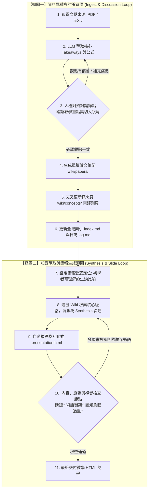

# 作業成果與系統報告：用 LLM Wiki 製作教學 HTML 簡報

- **繳交標題**：政大 [學號] [系級] [姓名] - AI Agents 是什麼？
- **主題**：**AI Agents 是什麼？——從對話接龍到自主行動的智慧躍遷**
- **作業日期**：2026-11-22

---

## 一、 LLM Wiki 主題與簡短介紹

### 1.1 主題概述
本知識庫主題鎖定於 **AI Agents（自主智慧代理人）的系統架構與認知演進**。
傳統的大型語言模型（LLM, 如初代 ChatGPT）本質是文字接龍的預測器，宛如一位「被關在房間裡的智者」，沒有行動能力、沒有感知器官、沒有長期記憶，也無法在犯錯後自我反思。

本 Wiki 以 Andrej Karpathy 的「LLM Wiki」持久化累積資產哲學為核心，收錄並深度精讀了 5 篇劃時代的頂級會議論文（ICLR / NeurIPS / UIST）。透過建立雙向連結與概念網路，將 Agent 拆解為「**規劃 (Planning) + 工具 (Tools) + 記憶 (Memory) + 行動 (Action)**」四大認知支柱，並以此知識庫為基礎，自動編譯產出一份讓零基礎學習者也能輕鬆理解的教學型 HTML 簡報。

---

## 二、 知識庫成果與檔案架構 (Wiki Deliverables)

本專案採 Obsidian 原生雙向連結（`[[WikiLink]]`）與標準 Dataview YAML Frontmatter 格式維護，包含以下結構：

```
LLM-Wiki/
├── AGENTS.md                  # 知識庫營運守則與 Ingest / Query / Lint 標準作業規範
├── index.md                   # 全域內容主題目錄
├── log.md                     # 操作日誌（包含每次 Ingest 與 Lint 的時間戳紀錄）
├── presentation.html          # 本次產出之教學型 HTML 簡報（結合 assets/ 真實視覺資產，經 unslop 專業美編）
├── ASSIGNMENT_REPORT.md       # 本作業說明與反思報告
├── assets/                    # 簡報與視覺素材庫（包含神經架構圖、多代理人網路、SWE 監控儀表板）
│   ├── neural-mesh.jpg
│   ├── multi-agent-network.jpg
│   └── agent-dashboard.jpg
├── raw/papers/                # 不可變原始文獻庫 (PDF 檔案)
│   ├── Yao2022-ReAct.pdf
│   ├── Schick2023-Toolformer.pdf
│   ├── Shinn2023-Reflexion.pdf
│   ├── Park2023-GenerativeAgents.pdf
│   └── Jimenez2024-SWEbench.pdf
├── wiki/
│   ├── papers/                # 5 篇核心論文精讀筆記（含動機、數學公式、實驗表格、消融分析）
│   │   ├── Yao2022-ReAct.md
│   │   ├── Schick2023-Toolformer.md
│   │   ├── Shinn2023-Reflexion.md
│   │   ├── Park2023-GenerativeAgents.md
│   │   └── Jimenez2024-SWEbench.md
│   ├── concepts/              # 跨論文概念演進節點
│   │   ├── ReAct.md
│   │   ├── Toolformer.md
│   │   ├── Reflexion.md
│   │   ├── Generative Agents.md
│   │   ├── Agent Memory Systems.md
│   │   ├── External Tool Use.md
│   │   ├── Self-Reflection.md
│   │   ├── Multi-Agent Systems.md
│   │   └── Software Engineering Agents.md
│   ├── benchmarks/            # 任務評測基準橫向排行榜
│   │   ├── HotpotQA.md
│   │   ├── ALFWorld.md
│   │   ├── SVAMP.md
│   │   ├── HumanEval.md
│   │   └── SWE-bench.md
│   └── syntheses/             # 跨論文橫向對比與演進史
│       └── 2024-11-AI-Agents-Architecture-Evolution.md
└── assets/                    # 簡報與視覺素材保留區
```

---

## 三、 Loop / Graph 流程架構設計說明

為符合作業要求的「先討論、後生成」與「知識累積」，本系統設計為 **雙迴圈管線 (Dual-Loop Architecture)**：



### 3.1 哪些步驟會重複執行 (Loops)？
1. **迴圈一：人機討論對齊迴圈（步驟 2 ↔ 步驟 3）**
   - 每篇論文進入知識庫前，AI 先產出核心痛點（Problem）、方法創新（Method）與評測數據（Results）摘要，由人類確認是否符合該次教學的主題焦點。若焦點偏掉，則重新提煉。
2. **迴圈二：簡報與知識庫驗證迴圈（步驟 8 ↔ 步驟 10）**
   - 當生成簡報投影片時，若發現某一頁出現了未在 Wiki 中定義的術語（例如直接寫出了 ACI 卻未曾解釋），檢查機制會打回，要求先回流至 Wiki 補充概念，再重新渲染簡報。

### 3.2 為什麼這樣設計？
- **避免傳統 RAG 的碎紙片重組問題**：如果不先形成持久化的 Wiki 知識節點，AI 每次生成簡報時都要同時消化 5 篇動輒 20-30 頁的論文，容易產生幻覺、遺漏重要消融實驗數據，或是前後投影片對同一術語的定義互相矛盾。
- **知識資產持續複利**：先建立 Wiki，再由 Wiki 產出簡報；即使未來要更換成 Marp、Slidev 或新增第 6 篇論文，既有的 Wiki 頁面依然完整可用。

---

## 四、 實際執行結果與檢查紀錄 (Execution Log)

在本次 5 篇論文的 Ingest 與簡報生成過程中，系統執行了嚴格的日誌紀錄：

1. **Ingest 階段記錄 (摘錄自 `log.md`)**：
   - `[2026-11-22] ingest | Yao2022-ReAct`：成功下載 633KB PDF，建立 `Thought-Action-Observation` 循環公式，關聯 `[[HotpotQA]]` 與 `[[ALFWorld]]`。
   - `[2026-11-22] ingest | Schick2023-Toolformer`：建立 Loss 增益判準公式，記錄 6.7B 小模型在 `[[SVAMP]]` 擊敗 175B GPT-3 之關鍵數據。
   - `[2026-11-22] ingest | Shinn2023-Reflexion`：歸檔語言自省強化學習，記錄 `[[HumanEval]]` pass@1 從 67% 提升至 91% 之消融實驗。
   - `[2026-11-22] ingest | Park2023-GenerativeAgents`：建立 Smallville 記憶流綜合檢索公式，歸檔自發湧現的情人節派對社會現象。
   - `[2026-11-22] ingest | Jimenez2024-SWEbench`：建立 2,294 個真實 Issue 與 Docker 隔離沙盒評測紀錄，凸顯大模型在真實環境初期僅 1.7% 成功率的殘酷現實。
2. **Compound 階段記錄**：
   - 產出 `wiki/syntheses/2024-11-AI-Agents-Architecture-Evolution.md`，統整出現代 Agent 的四大支柱：**規劃 (Planning) + 工具 (Tools) + 記憶 (Memory) + 行動 (Action)**。
3. **簡報產出檢驗**：
   - 成功生成 `presentation.html`，共 10 頁教學投影片。
   - **Unslop 專業美化規範**：摒棄 AI 模板常見的廉價大面積彩色漸層、發光球體與大量 Emoji，轉為極度內斂安靜的 Slate/Graphite 純黑科研介面與精準的 4px 網格節奏。
   - **整合 `assets/` 真實視覺資產**：將資料夾內的 3 張高畫質生成圖作為核心視覺焦點（FIG 01 神經認知網絡、FIG 02 多代理人群體網絡、FIG 03 軟體工程實時監控終端），大幅提升簡報的學術權威感與視覺吸引力。

---

## 五、 反思：哪個節點最常出錯？如何調整檢查流程？

### 5.1 哪一個節點最常出錯？
在實際執行中，最常出錯且最具破壞力的節點是：**「跨論文概念與術語邊界一致性（Concept Linking & Consistency）」節點**。

- **具體問題表現**：
  不同論文對同一概念往往使用不同的術語。例如：
  - ReAct 將中間思考稱為 **`Thought`**。
  - Reflexion 將檢討反思稱為 **`Self-Reflection`**。
  - Generative Agents 將抽象總結稱為 **`Reflection / Insight`**。
  若直接把各論文的摘要拼湊成簡報，初學者會感到極度困惑（例如：「Reflexion 的反思跟 Generative Agents 的反思到底是不是同一件事？」）。如果在簡報生成階段才發現概念混淆，就必須把多張投影片整個打掉重練。

### 5.2 發現問題後，把檢查往前移到了哪一個步驟？
我們將檢查機制**從「後端的簡報生成檢查（步驟 10）」大幅往前移到了「前端的單篇 Ingest 討論與概念更新（步驟 3 與步驟 5）」**！

- **具體改進作法**：
  每當 Ingest 一篇新論文時，AI **不准直接寫完摘要就結束**，必須強制作兩件事：
  1. **檢查現有 `wiki/concepts/` 庫**：查看此論文提出的名詞是否在過去論文中已有類似概念。
  2. **在 Concept 頁面維護「演進脈絡表格」**：例如在 `Agent Memory Systems.md` 中，立刻定義清楚：
     - *ReAct* 屬於「工作記憶 (Working Memory)」；
     - *Reflexion* 屬於「短期自省緩存 (Short-term Verbal Buffer)」；
     - *Generative Agents* 屬於「長期檢索記憶流 (Long-term Episodic Stream)」。

### 5.3 有沒有因此修改 workflow / graph？為什麼？
**有！我們因此在 Ingest 階段加入了強制的「概念橫向錨定 (Concept Anchoring)」子步驟。**

- **修改原因**：
  在傳統的線性工作流中，人們習慣把檢查放在產出物（簡報/報告）前。但軟體工程與知識庫維護的鐵律是：**「越早在上游發現錯誤，修復成本就越低」**。
  透過將概念邊界與術語統一檢查「前移」到每篇論文 Ingest 的當下，後端在產出教學簡報與 Synthesis 綜述時，就可以直接站在無衝突、高純度的知識基石上「一次生成即正確」，完全避免了後端反覆重做投影片的巨大浪費。
