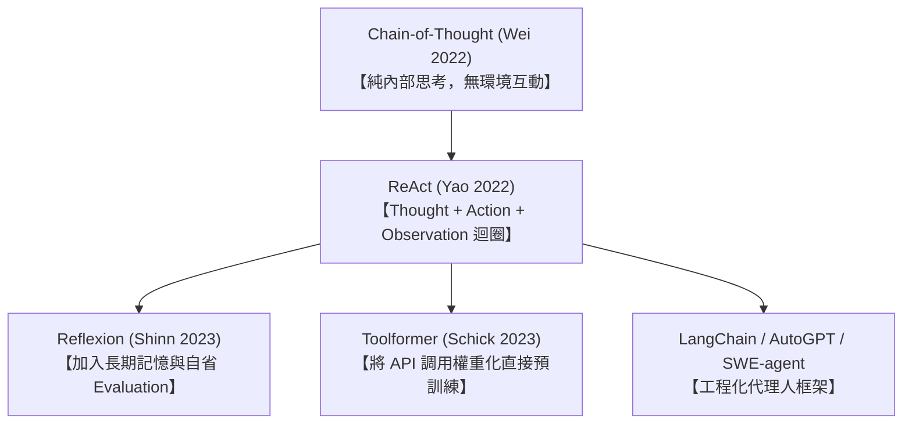

# ReAct (Reasoning and Acting)

## 1. 概念定義與核心理念

**ReAct** 是大型語言模型（LLM）代理人架構的基石設計範式，由普林斯頓大學與 Google Brain 於 2022 年（ICLR 2023）共同提出。其核心概念是**將「內部思維推理（Reasoning）」與「外部環境行動（Acting）」緊密結合在同一個交替迴圈中**。

在 ReAct 誕生前，AI 社群主要分為兩派：
1. **純推理 (Reasoning only, 如 CoT)**：擅長複雜邏輯推導，但沒有眼睛和手，與環境隔絕，容易產生嚴重的「事實幻覺 (Hallucination)」。
2. **純行動 (Acting only, 如 WebGPT)**：擅長按鈕與調用工具，但沒有大腦深思熟慮，缺乏多步驟長程規劃能力，容易陷入盲目試錯。

ReAct 透過人類「邊思考、邊行動、邊觀察」的認知機制，創造了 **`Thought -> Action -> Observation`** 的黃金三段式互動循環。

---

## 2. 核心數學與架構機制

### 2.1 聯合動作空間
傳統環境下，代理人的動作空間為 $\mathcal{A}$。ReAct 將其擴增為：
$$\mathcal{A}_{ReAct} = \mathcal{A} \cup \mathcal{T}$$
- $\mathcal{T}$ 為語言思考空間（Mental Actions），不改變外部環境狀態，其觀察值 $o_t = \emptyset$，目的在於分解子目標、反思中間狀態。
- $\mathcal{A}$ 為外部行動空間（Physical/Digital Actions），產生真實世界環境回饋 $o_t \in \mathcal{O}$。

### 2.2 核心三階段交替流程
1. **Thought（思考）**：LLM 根據當前歷史上下文，用自然語言評估目標進度、決定下一步策略。
2. **Action（行動）**：LLM 產出具體的指令結構（例如 `Search[query]`、`Calculate[expr]` 或 `Finish[answer]`）。
3. **Observation（觀察）**：外部環境（如搜尋引擎、程式直譯器或資料庫）執行該 Action 並將真實結果回傳給 LLM。

---

## 3. 歷史演進與衍生框架

ReAct 是現代 AI Agent 的始祖架構，後續無數代理人系統均在其基礎上演進：

- **[[Yao2022-ReAct]]**：首次確立該架構，並在問答與具身決策任務證明其能大幅降低幻覺。
- **[[Reflexion]]**：為 ReAct 補齊了「長期跨任務自省記憶」，讓 Agent 失敗時能總結教訓不重蹈覆轍。
- **[[Toolformer]]**：將 ReAct 的 Prompt 引導方式推進到模型底層微調訓練。
