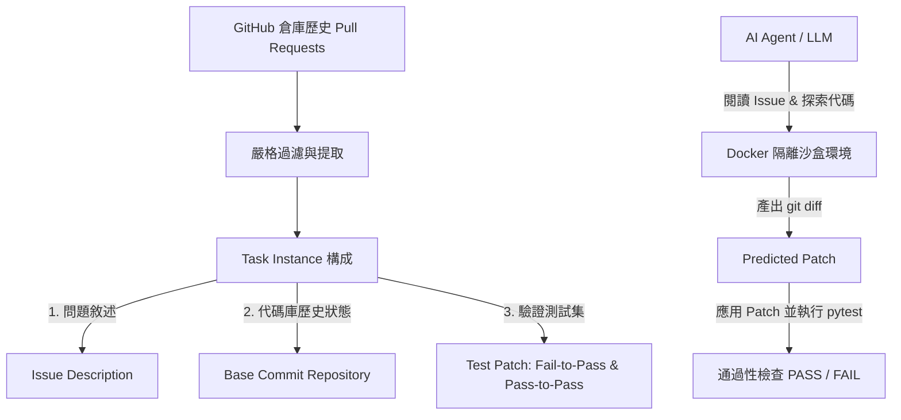

# SWE-bench: Can Language Models Resolve Real-World GitHub Issues?

## 1. 核心動機與欲解決痛點 (Motivation & Problem)

在 2023 年之前，學術界對程式設計語言模型（Code LLMs）的評測高度依賴如 [[HumanEval]] 或 MBPP 等基準。然而，這些評測與真實世界的軟體工程存在巨大的**代溝 (Reality Gap)**：
1. **單一函式 vs. 大型真實代碼庫**：
   - HumanEval 只是獨立的 Python 演算法小函數（通常少於 20 行），而真實軟體專案涉及數萬乃至數百萬行代碼、跨檔案依賴與複雜的目錄結構。
2. **玩具測試 vs. 真實 Issue 解決**：
   - 真實工程師的工作並非從零寫刷題程式，而是閱讀 GitHub Issue 描述、在海量代碼中定位 Bug、編寫 Patch、並確保通過回歸測試（Regression Tests）。
3. **過度樂觀的評測分數**：
   - 模型在 HumanEval 上動輒取得 80%~90% 以上的高分，但在真實軟體開發中卻頻繁崩潰。

**SWE-bench 的核心動機**：打造第一個基於**真實開源 GitHub 倉庫與 Issue** 的端到端軟體工程評測基準。它不再只是考模型「寫不寫得出函式」，而是評估一個 **AI Agent 是否能像初階或中階軟體工程師一樣，自主修復真實專案中的 Bug**。

---

## 2. 核心方法與數據集構建 (Dataset & Execution Sandbox)

### 2.1 數據集構建流程
作者從 12 個知名 Python 開源庫（如 `django`、`scikit-learn`、`sympy`、`matplotlib`、`requests` 等）中精選出 **2,294 個真實修復實例 (Task Instances)**：

### 2.2 雙重測試驗證機制 (Fail-to-Pass & Pass-to-Pass)
評測的通過標準極度嚴苛，必須同時滿足：
1. **$FAIL \to PASS$**：針對本 Issue 暴露出的 Bug 測試，在修復前為失敗，套用 Agent 的 Patch 後必須全部通過。
2. **$PASS \to PASS$**：既有的所有功能回歸測試，在修復後必須依然全部通過（不得引入新 Regression Bug）。

---

## 3. 實驗設計與關鍵結果 (Experiments & Results)

SWE-bench 發表時，向當時所有頂尖 LLM 與 Agent 進行了「殘酷的現實檢驗」：

### 3.1 震撼業界的初期榜單成績 (Initial Results)

| 模型 / 系統 | 提示策略 / 系統架構 | 成功修復率 (%) | 2,294 題中解決題數 |
| :--- | :--- | :---: | :---: |
| Claude 2 | Retrieval-augmented Prompt | 4.8% | 110 / 2,294 |
| GPT-4 (Base) | Retrieval-augmented Prompt | 1.7% | 40 / 2,294 |
| GPT-3.5 | Retrieval-augmented Prompt | 0.5% | 12 / 2,294 |
| **SWE-agent + GPT-4** (後期開源) | Agent-Computer Interface (ACI) | **12.5%** | 286 / 2,294 |
| **現代前沿 Agent (2024 後期)** | 結合專用工具、搜尋與驗證 | **~40% - 50%** | 持續演進中 |

> **核心震撼**：原本在 [[HumanEval]] 拿下近 90% 的強大模型，在真實工程任務面前的解決率一度跌破 **5%**！這證明了真實工程環境需要的不僅僅是代碼生成，更需要複雜的**檢索定位、環境執行與反思修正能力**。

---

## 4. 消融實驗與關鍵洞察 (Ablation Study & Insights)

1. **Bug 定位（Localization）是最難的瓶頸**：
   - 實驗發現，若人為將代碼檔案鎖定（告訴模型 Bug 在哪一行附近），修復成功率可直接提升數倍。這說明當前 Agent 最脆弱的環節是「在百萬代碼中找到問題所在」。
2. **Agent-Computer Interface (ACI) 介面設計的關鍵性**：
   - 隨後普林斯頓提出的 SWE-agent 證明：不要讓 Agent 直接用傳統 bash 命令，而是設計專屬的「搜尋代碼」、「瀏覽特定檔案段落」的特製工具，能將成功率翻倍。

---

## 5. 局限性與未來方向 (Limitations & Future Work)

1. **評測環境構建成本巨大**：
   - 每個 Issue 都需要依賴特定版本的 Docker Image 與 Python 環境，執行完整測試耗時昂貴。
   - 衍生出 **SWE-bench Lite**（精選 300 題）與 **SWE-bench Verified**（經人工覆核無爭議題型）。
2. **測試用例洩漏與過擬合風險**：
   - 開源代碼庫可能存在於模型預訓練資料中。

---

## 6. 相關文獻與關聯節點 (Connections & Graph)

- **前驅評測**：
  - [[HumanEval]] (Chen et al., 2021)：傳統單函數程式評測。
- **架構依賴**：
  - [[Yao2022-ReAct]] 與 [[Shinn2023-Reflexion]]：構成現代 SWE-agent 反覆除錯與驗證的核心基底。
- **核心概念關聯**：
  - [[SWE-bench]]
  - [[Software Engineering Agents]]
  - [[Agent Benchmark Rigor]]
