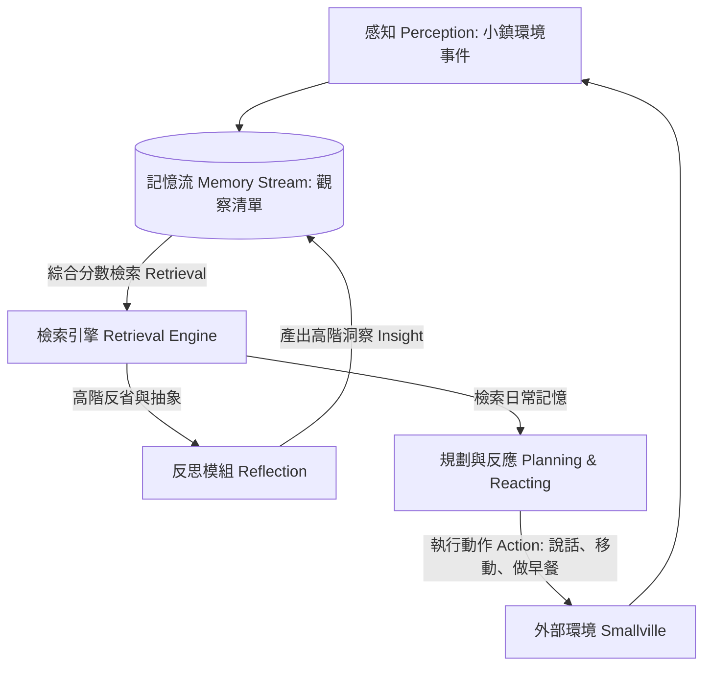

# Generative Agents: Interactive Simulacra of Human Behavior

## 1. 核心動機與欲解決痛點 (Motivation & Problem)

過去五十年來，人工智慧與計算社會科學領域一直渴望創造具備逼真人類行為的計算模擬體（Simulacra）。然而過去的架構主要依賴預先定義的手寫狀態機（Finite State Machines）或規則系統，缺乏長期的適應性與動態人際交互能力。

當大型語言模型（LLM）興起後，直接使用 LLM 驅動角色仍面臨三大嚴重技術痛點：
1. **上下文長度限制與遺忘**：角色無法儲存並回憶幾天前或與其他角色交談過的龐大生活細節。
2. **缺乏高階抽象思維**：簡單的角色只會被動對眼前刺激做反應，無法從雜亂的日常瑣事中「總結出對自我的認知或對他人的看法」。
3. **長程目標規劃缺失**：無法制定從早到晚、層次分明的時間表，並根據突發事件（如朋友邀約派對）動態調整計畫。

**Generative Agents 的核心動機**：在一個名為 Smallville 的 2D 像素模擬沙盒小鎮中，注入 25 位擁有各自姓名、職業、性格與社會關係的自主 Agent。作者提出了一套完整的**計算認知架構（Cognitive Architecture）**，讓 Agent 能自主生活、傳播八卦、舉辦情人節派對、結交新朋友，甚至主動協調社交活動。

---

## 2. 核心方法與數學架構 (Method & Mathematical Formulation)

Generative Agents 的核心架構由三大引擎構成：**記憶流（Memory Stream）**、**反思（Reflection）** 與 **規劃（Planning & Reacting）**。

### 2.1 記憶流與綜合檢索評分 (Retrieval Function)
記憶流是一個持久化日誌，按時間順序儲存成千上萬條觀察（Observations）。當 Agent 遇到新刺激時，系統透過數學公式計算每條記憶的檢索相關度：
$$\text{Score}(m) = \alpha_{\text{recency}} \cdot s_{\text{recency}} + \alpha_{\text{importance}} \cdot s_{\text{importance}} + \alpha_{\text{relevance}} \cdot s_{\text{relevance}}$$

三大評分分量定義：
1. **時效性 (Recency, $s_{\text{recency}}$)**：指數衰減函數，反映距上次被檢索的時間距離：
   $$s_{\text{recency}} = \gamma^{h}$$
   其中 $\gamma = 0.99$，$h$ 為自上次訪問以來的遊戲小時數。
2. **重要性 (Importance, $s_{\text{importance}}$)**：
   - 模型在初次存入記憶時，自動向 LLM 評估該事件的重要程度（評分 1 到 10）。
   - 例如：「刷牙」的重要性為 1；「得知伴侶出軌」或「決定參選鎮長」的重要性為 10。
3. **相關性 (Relevance, $s_{\text{relevance}}$)**：
   - 計算當前感知情境之 Embedding 向量與歷史記憶文字 Embedding 的餘弦相似度（Cosine Similarity）：
     $$s_{\text{relevance}} = \frac{\mathbf{e}_{\text{query}} \cdot \mathbf{e}_{\text{memory}}}{\|\mathbf{e}_{\text{query}}\| \|\mathbf{e}_{\text{memory}}\|}$$

所有分數經 Min-Max 正規化後線性加權，得分最高的 Top-$K$ 條記憶被取出注入 Prompt。

### 2.2 反思機制 (Reflection)
當最近未反思的記憶重要性累積分數超過閾值（通常為 150）時，觸發反思機制：
1. 讓 LLM 回顧最近 100 條記憶，提出 3 個最高階的探索性問題（例如：「*Klaus Mueller 真正熱愛的研究方向是什麼？*」）。
2. 針對該問題檢索相關記憶，由 LLM 生成高階洞察（Insights），並作為新記憶節點存入 Memory Stream（形成樹狀層次記憶）。

### 2.3 規劃與動態反應 (Planning and Reacting)
- **自頂向下分層規劃**：首先制定當天粗略時間表（例如：8:00 起床、9:00 咖啡店寫作、12:00 午餐），再逐層分解為 15 分鐘乃至具體行動指令。
- **動態反應**：在執行過程中感知周遭環境，若發現咖啡機著火或遇到鄰居，即時中斷當前計劃，發起自然對話或應急反應。

---

## 3. 實驗設計與關鍵結果 (Experiments & Results)

### 3.1 湧現社會行為 (Emergent Social Behaviors)
在長達多個虛擬天數的模擬中，產生了多項完全未經硬編碼的人類社會行為：
1. **資訊擴散（Information Diffusion）**：
   - 實驗者僅告訴一位居民 Isabella 想要在咖啡館舉辦情人節派對。
   - 透過居民間的日常寒暄，該消息在小鎮內擴散，到了派對當天，多位 Agent 準時出席並主動邀請舞伴。
2. **社會關係演進（Relationship Formation）**：
   - 互不相識的居民在書店偶遇聊起共同興趣，數天後成為互訪好友。
3. **協同合作（Coordination）**：
   - Agent 主動協調佈置派對場地與分工。

### 3.2 評測與消融研究
在採訪式評測（Interview Evaluation）中，評估 Agent 的自覺性、記憶力、規劃能力與深度對話：

| 架構配置 | 記憶完整性 | 反思能力 | 規劃執行力 | 總體真實感得分 |
| :--- | :---: | :---: | :---: | :---: |
| 純 LLM（無記憶/無反思） | 1.8 / 5 | 2.1 / 5 | 1.5 / 5 | 1.9 / 5 |
| 無反思機制 (No Reflection) | 3.5 / 5 | 2.2 / 5 | 3.2 / 5 | 3.1 / 5 |
| 無規劃機制 (No Planning) | 3.7 / 5 | 3.8 / 5 | 2.1 / 5 | 3.3 / 5 |
| **完整架構 (Generative Agents)** | **4.6 / 5** | **4.5 / 5** | **4.4 / 5** | **4.5 / 5** |

---

## 4. 消融實驗與關鍵洞察 (Ablation Study & Insights)

1. **反思模組是產生「人格穩定度」的樞紐**：
   - 缺乏反思的 Agent 只是一台短期反應機器，無法維持長久一貫的價值觀與人生目標。
2. **幻覺傳播的社會性風險**：
   - 一旦某位 Agent 在對話中產生事實幻覺（如虛構鎮長貪污），該錯誤資訊會隨社交網絡擴散給其他 Agent，形成整體的虛假集體記憶。

---

## 5. 局限性與未來方向 (Limitations & Future Work)

1. **計算與 API 成本極度高昂**：
   - 25 個 Agent 運作 2 天模擬消耗了數百萬 Tokens。
2. **長程時間尺度下的記憶漂移**：
   - 當模擬延伸至數月時，記憶流過於龐大，單純向量相似度檢索易被歷史噪訊干擾。

---

## 6. 相關文獻與關聯節點 (Connections & Graph)

- **前驅繼承**：
  - [[Shinn2023-Reflexion]]：啟發了利用語言進行反思並寫入記憶的機制，Generative Agents 將其從單一任務推展至開放社會模擬。
- **核心概念關聯**：
  - [[Generative Agents]]
  - [[Agent Memory Systems]]
  - [[Multi-Agent Systems]]
