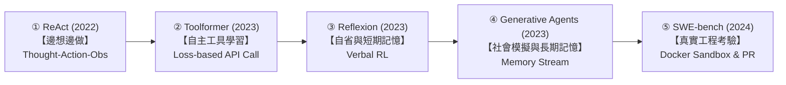

# AI Agents 架構演進史：從對話接龍到自主決策與工程代理

## 1. 綜述引言：什麼是 AI Agent？

如果說傳統大型語言模型（LLM）是「**被關在房間裡的智者**」——他讀過萬卷書，能寫出優美的文字，但沒有眼睛、沒有雙手、也沒有任何實體記憶，一走出房間就忘光一切；那麼 **AI Agent（智慧代理人）** 就是**賦予這位智者感知器官、行動四肢、日記本與工具箱，讓它能夠走入真實環境自主解決問題的完整體系**。

本文橫向梳理 5 篇劃時代的經典文獻，完整繪製現代 AI Agent 的演進軌跡：

---

## 2. 五大里程碑架構對比

| 演進階段 | 代表文獻 | 解決之核心痛點 | 核心機制 / 數學架構 | 評測指標突破 |
| :--- | :--- | :--- | :--- | :--- |
| **1. 行動與推理協同** | [[Yao2022-ReAct]] | 純推理有幻覺、純行動無規劃 | 擴展動作空間 $\mathcal{A} \cup \mathcal{T}$，三段式交替 | ALFWorld 成功率 45% $\to$ **71%** |
| **2. 工具自主內化** | [[Schick2023-Toolformer]] | Prompt 工具調用開銷大且缺乏邊界 | 自監督 Loss 增益過濾 $L_{\text{w/o}} - L_{\text{w/}} \ge \tau$ | 6.7B 小模型在 SVAMP 打敗 **175B GPT-3** |
| **3. 語言自省強化** | [[Shinn2023-Reflexion]] | 重複試錯陷入死循環、RL 權重代價大 | Evaluator + Verbal Self-Reflection + Memory Buffer | HumanEval pass@1 67% $\to$ **91%** |
| **4. 長期認知記憶** | [[Park2023-GenerativeAgents]] | 無法長久生活、遺忘細節、缺乏抽象觀點 | 記憶流檢索公式 $\text{Score} = \alpha_r s_r + \alpha_i s_i + \alpha_{rel} s_{rel}$ | 湧現出情人節派對籌辦等自發社會行為 |
| **5. 真實世界工程驗證** | [[Jimenez2024-SWEbench]] | 刷題指標無法反映真實軟體開發能力 | 2,294 個真實 GitHub Issue + Fail-to-Pass 沙盒測試 | 揭露初期大模型在真實修復率僅 **~1-5%** 的殘酷現實 |

---

## 3. 關鍵架構演進洞察 (Core Insights)

### 3.1 代理人的認知四要素（The 4 Pillars of an Agent）
綜合 5 篇文獻，現代 AI Agent 已經收斂為四大支柱：
1. **Planning（規劃大腦）**：由 [[Yao2022-ReAct]] 與 [[Park2023-GenerativeAgents]] 所證明的層級分解與動態調整。
2. **Tools（行動工具）**：由 [[Schick2023-Toolformer]] 證明的自主 API 喚起與邊界控制。
3. **Memory（記憶系統）**：由 [[Shinn2023-Reflexion]]（短期自省）與 [[Park2023-GenerativeAgents]]（長期檢索流）構成的雙層記憶體系。
4. **Action & Execution（環境執行）**：由 [[Jimenez2024-SWEbench]] 所樹立的嚴格隔離沙盒與真實世界反饋。

---

## 4. 結論與教學啟示

對於初學者而言，理解 AI Agent 的關鍵在於明白：**Agent 並不是一個單一的神奇大模型，而是一套圍繞著大模型構建的「認知軟體工程系統」**。正是推理、工具、反思與記憶的有機結合，才讓單純的文字預測器轉化為具備能動性的自主助理。
